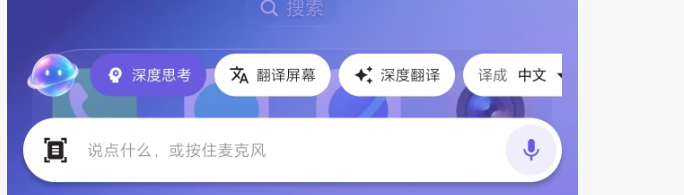

# 小克（语音助手）

一款以屏幕翻译为起点的 Android 语音助手：替换已测试手机上的原厂助手入口，手机本地 OCR，将文字交给自己选择的模型，再把译文绘制回截图中的对应位置。

当前源码版本：**1.0.2**。采用 Kotlin、Jetpack Compose 和 ML Kit。仓库沿用 `yyzs` 名称，应用包名保持 `yyzs.lqkj.uk`，便于使用相同签名升级。

**目前仅测试过荣耀 YOYO 的替换。** 已验证设备为 HONOR AAK-AN00 / Android 16；这不代表所有荣耀机型、MagicOS 版本或其他厂商助手均可替换。细节见 [实验与测试](docs/EXPERIMENTS.md)。

| 替换前：荣耀 YOYO | 替换后：小克 |
| --- | --- |
|  |  |

用户提供的入口效果对比：长按电源键后，从原厂助手面板切换为小克的翻译与对话面板。

[无线调试与 AI Agent 配置](docs/AGENT_SETUP.md) · [实验与测试](docs/EXPERIMENTS.md) · [隐私与数据流](docs/PRIVACY.md) · [问题反馈](docs/FEEDBACK.md)

## 为什么做小克

最初的需求很直接：保留“长按电源键就能叫出助手”的使用习惯，同时解决原厂屏幕翻译在作者使用中对含粗口等普通翻译材料过度拒绝的问题。翻译应尽量保留原意，而翻译模型、服务地址和数据去向应由使用者选择。

小克接管入口后，由自己的截图、OCR 和翻译流程处理请求，不再调用 YOYO 的屏幕翻译服务。应用源码中没有额外实现敏感词拒译层；最终是否拒答、怎么处理内容，仍取决于所选模型及其服务规则。小克不承诺任何模型都不会拒译。

另一个目标是让数据去向可查：快速模式只把 OCR 文字交给配置的模型；深度模式才额外发送截图。应用不需要通过开发者自己的中转服务器才能使用，也没有开发者额外设置的用户体验改进计划。第三方 SDK 和可选服务的实际数据流在下文及隐私说明中单列。

> 源码可用：允许实质改进后的商业开发，限制没有实质改进的套壳收费。详见 [LICENSE](LICENSE) 和 [许可示例](docs/LICENSING.md)。

## 功能

- **屏幕翻译**：本地 OCR、段落重组、断行合并、译文原位绘制；复制、分享、保存及切换原文。
- **快速 / 深度翻译**：快速模式发送识别文字；深度模式额外发送截图和坐标，让支持图片的模型结合画面处理。
- **流式 / 一次性显示**：设置 → 翻译 → 流式输出，默认开启；关闭后等全部结果完成再一次显示。该开关控制屏幕译文呈现方式。
- **文本和语音输入**：输入“翻译”或“屏幕翻译”触发屏幕翻译，也可以直接输入待译文字。
- **助手面板和聊天记录**：文本对话、语音输入、回复朗读和历史会话。
- **手机工具**：打开应用、打开系统设置、调整媒体音量、设置闹钟 / 倒计时、导航和打开拨号界面；实际支持取决于设备和权限。
- **可配置接口**：自行填写模型服务地址、模型名和 API Key。文本服务按 Chat Completions 风格接口调用；不同服务商的扩展参数和工具调用兼容性需要验证。
- **实验性实时语音**：包含可配置 WebSocket 语音会话实现，需要与当前客户端协议兼容的服务。它不是后台唤醒词功能。

## 开始使用

1. 安装自行构建的 APK，进入设置 → 模型接口，填写自己的服务地址、模型名和 API Key，保存并测试连接。
2. 进入设置 → 唤醒方式，开启“小克 屏幕截图”无障碍服务。
3. 在系统快捷设置面板添加“屏幕翻译”磁贴；也可设置为默认数字助理，使用系统提供的助手入口。
4. 打开待译页面，触发翻译；在设置 → 翻译中选择目标语言、自动翻译和输出方式。

应用最低支持 Android 10（API 29）；**无障碍截图翻译需要 Android 11（API 30）及以上**。当前构建只包含 `arm64-v8a`。

长按电源键、默认数字助理和无障碍服务能否持续生效，取决于手机系统。YOYO 在测试过程中曾改回语音交互服务；实验通过可恢复的停用原厂助手及重新绑定处理，具体命令与恢复步骤见 [配置指南](docs/AGENT_SETUP.md)。快捷设置磁贴可作为另一入口；它也依赖无障碍服务仍然有效。

小克目前没有“你好小克”的全天后台唤醒词功能，也不等于取得原厂助手的全部系统能力。受系统保护的窗口可能无法截图。

## 数据如何流转

**小克不额外设置“用户体验改进计划”，不包含要求用户为改进产品而向开发者上传内容或使用记录的条款。项目没有向开发者网站或服务器自动回传截图、录音、对话、API Key、使用记录或崩溃日志的机制。**

功能请求和现用第三方依赖仍会产生数据流：模型接口、Google ML Kit、语音服务、搜索等分别按各自用途和政策处理数据。发送反馈邮件属于用户主动提供信息，不是应用自动收集。

| 功能 | 本机处理 | 可能发送到外部服务的数据 |
| --- | --- | --- |
| 快速屏幕翻译 | 截图、OCR、排版绘制 | OCR 文字及翻译要求，发送给配置的模型服务 |
| 深度屏幕翻译 | 截图、OCR、排版绘制 | OCR 文字、区域坐标及缩放后的截图，发送给配置的模型服务 |
| 助手对话 | 历史记录和工具执行 | 对话内容、工具结果及用于匹配应用的已安装应用名称等上下文 |
| 系统语音识别 | 由选定的识别服务处理 | 是否联网及发送何种音频，取决于所选识别服务 |
| 回复朗读 | 由系统 TTS 引擎处理 | 朗读文字可能交给在线语音引擎，取决于系统配置 |
| 实时语音 | 麦克风采集、音频播放 | 会话期间的音频及必要会话数据，发送给配置的语音服务 |
| 网页搜索和阅读 | 结果解析 | 查询发送给搜索服务；部分页面读取会使用 Jina Reader |
| ML Kit OCR SDK | 截图文字识别在本机完成 | SDK 官方披露的设备、应用、安装标识及性能诊断数据，发送至 Google |

API Key 保存在手机应用私有设置中，不写入本仓库。应用关闭了系统自动备份。截图 OCR 可在本机进行，**当前模型翻译仍依赖所配置服务，不能将整个应用视为完全离线翻译软件**。

“不经过原厂助手的翻译服务”不等于“整台手机绝不向厂商联网”。选用厂商语音识别或输入法时，它们自己的数据处理仍可能存在；Google SDK 的诊断行为也不能归为不存在。详见 [完整隐私说明](docs/PRIVACY.md) 和 [ML Kit 官方披露](https://developers.google.com/ml-kit/android-data-disclosure)。

## 构建

需要兼容本项目的 Android Studio、JDK 17 或更高版本，以及 Android SDK Platform 36。项目使用 Gradle Wrapper；依赖版本见 `gradle/libs.versions.toml`。

```bash
git clone https://github.com/linlanplus/yyzs.git
cd yyzs
./gradlew :app:assembleDebug
```

Windows PowerShell：

```powershell
.\gradlew.bat :app:assembleDebug
```

通过 Android Studio 配置 SDK 路径，或在本机创建 `local.properties`。该文件不提交。

- Debug APK：`app/build/outputs/apk/debug/app-debug.apk`
- Debug 应用包名：`yyzs.lqkj.uk.ocrpreview`，可与正式版并行安装。
- Release 应用包名：`yyzs.lqkj.uk`

### 发布签名

复制 `keystore.properties.example` 为本机的 `keystore.properties`，填写自己的签名信息，将密钥库放到被忽略的 `keystore/` 目录，再运行：

```powershell
.\gradlew.bat :app:assembleRelease
```

目前构建脚本在缺少发布签名配置时会退回 Debug 签名；正式分发请使用自己的发布签名。自建 APK 与原作者 APK 的签名不同，通常不能直接覆盖原作者版本。

### 检查与回归

```powershell
.\gradlew.bat :app:assembleDebug :app:assembleDebugAndroidTest :app:lintDebug
```

`app/src/androidTest` 包含真机 OCR、段落归并、擦除与排版、翻译结果 ID 校验及两种输出模式的回归用例。编译测试 APK 不等于已经在设备上执行测试。设备范围、记录、复现命令和未验证事项见 [实验与测试](docs/EXPERIMENTS.md)。

当前 `UpdateChecker` 的仓库配置留空，应用内自动检查更新尚未启用；源码发布不自动生成 APK Release。可在需要发布安装包时配置仓库并完善更新流程。

## 目录

| 路径 | 内容 |
| --- | --- |
| `app/src/main/java/yyzs/lqkj/uk/ocr` | 本地 OCR 和段落重组 |
| `app/src/main/java/yyzs/lqkj/uk/render` | 原文字形擦除与译文排版 |
| `app/src/main/java/yyzs/lqkj/uk/translate` | 模型请求和翻译结果协议 |
| `app/src/main/java/yyzs/lqkj/uk/assist` | 默认助手、无障碍截图和快捷磁贴 |
| `app/src/main/java/yyzs/lqkj/uk/agent` | 对话和手机工具 |
| `app/src/main/java/yyzs/lqkj/uk/live` | 实验性实时语音 |
| `app/src/main/java/yyzs/lqkj/uk/ui` | 助手面板和翻译结果界面 |

## 许可与贡献

原创代码和原创资源采用 [小克源码使用许可证 1.0](LICENSE)，属于 **Source Available**，并非 OSI 批准的开源许可证。本次项目更名不改变许可条款。

允许个人和企业使用、免费分享、实质改进后商业发布，以及将部分代码整合进自行开发的产品。改进后的产品仍以翻译为核心，或与本项目竞争，不会单独导致商用被禁止。单纯改名换图标、加支付和会员入口后售卖原有功能，不获许可。

本许可证不强制公开修改后的源码。分发须保留适用的许可和版权声明。第三方内容按其自己的条款处理，见 [第三方说明](THIRD_PARTY_NOTICES.md)。

提交原创贡献时，请确认你有权按本项目许可证提供该贡献；引入第三方代码或素材时一并附上来源及许可说明。

## 问题与 Bug 反馈

联系：[support@lqstudio.uk](mailto:support@lqstudio.uk)。请提供应用版本、机型及系统版本、触发方式、复现步骤、预期与实际结果，必要时附脱敏截图。不要提供 API Key、无线调试配对码或私密屏幕内容。可直接使用 [反馈模板](docs/FEEDBACK.md)。
