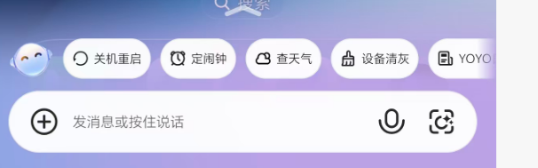

# 小克 · Xiaoke

替换手机原厂语音助手的 Android 助手，主打屏幕翻译。长按电源键叫出小克，截屏、本地 OCR，交给你自己选的模型翻译，再把译文画回原位。

An Android assistant that replaces your phone's stock voice assistant, built around screen translation. Long-press the power key, and Xiaoke takes a screenshot, runs OCR on the phone, sends the text to a model you choose, and draws the translation back in place.

> 当前版本 / Current version · **1.0.1**
>
> 目前只在荣耀 YOYO 上测试过替换（HONOR AAK-AN00 / Android 16）。
> Assistant replacement has only been tested with Honor YOYO (HONOR AAK-AN00 / Android 16).

| 替换前：荣耀 YOYO / Before: Honor YOYO | 替换后：小克 / After: Xiaoke |
| --- | --- |
|  |  |

## 为什么做 · Why

- **翻译审查太严：** 原厂助手的屏幕翻译，碰到带粗口的内容就经常拒绝翻译。小克接管入口后，翻译走自己的流程，不再经过 YOYO 的翻译服务，代码里也没有敏感词过滤。翻不翻由你选的模型决定。
- **隐私：** 小克自己的流程只把数据发给你配置的模型，不经过手机厂商的服务器，也没有开发者的中转服务器。软件里没有“用户体验改进计划”，也没有任何要求你上传数据的条款。详见 [隐私说明](docs/PRIVACY.md)。

---

- **Translation filtering was too strict:** the stock assistant's screen translation often refused text that contained swearing. Once Xiaoke takes over the entry point, translation runs through its own pipeline instead of YOYO's service, and the code has no keyword filter. Whether something gets translated is up to the model you pick.
- **Privacy:** Xiaoke's own pipeline sends data only to the model you configure. Nothing goes through the phone vendor's servers or a developer relay. The app has no "user experience improvement program" and no terms asking you to upload data. See the [privacy notes](docs/PRIVACY.md).

## 功能 · Features

- **屏幕翻译：** 本地 OCR，自动合并断行、重组段落，译文画回原位；可复制、分享、保存，也能切回原文。
- **快速 / 深度模式：** 快速模式只发文字；深度模式额外发截图，适合需要看画面的内容。
- **流式输出：** 默认边翻边显示，也可以改成翻完再一起显示。
- **对话和语音：** 文字对话、语音输入、朗读回复、历史会话；还能开应用、调音量、定闹钟、导航。
- **模型自己配：** 填服务地址、模型名和 API Key，兼容 Chat Completions 风格的接口。

---

- **Screen translation:** on-device OCR, line merging and paragraph grouping, with the translation drawn over the original. Copy, share, save, or flip back to the source text.
- **Fast / deep mode:** fast mode sends text only; deep mode also sends the screenshot, for content that needs visual context.
- **Streaming:** shows results as they arrive by default, or all at once when finished.
- **Chat and voice:** text chat, voice input, spoken replies, and chat history. It can also open apps, change volume, set alarms, and start navigation.
- **Bring your own model:** set the endpoint, model name, and API key. Works with Chat Completions–style APIs.

## 下载 · Download

从 [Releases](https://github.com/linlanplus/yyzs/releases) 下载 APK。需要 Android 10 以上，截图翻译需要 Android 11 以上，只支持 `arm64-v8a`。

Download the APK from [Releases](https://github.com/linlanplus/yyzs/releases). Requires Android 10+, screen translation needs Android 11+, `arm64-v8a` only.

装好后：设置 → 模型接口，填地址、模型和 Key；设置 → 唤醒方式，开启“小克 屏幕截图”无障碍服务，并把小克设为默认数字助理。

After installing: go to Settings → Model API and fill in the endpoint, model, and key. Then in Settings → Wake method, turn on the "小克 屏幕截图" accessibility service and set Xiaoke as the default digital assistant.

## 用 AI Agent 配置 · Setting up with an AI agent

在荣耀上，只在系统设置里选默认助手不够：YOYO 会把 `voice_interaction_service` 改回它自己，长按电源键还是会打开 YOYO。要通过 ADB 改几项系统设置，这一步可以交给电脑上的 AI 编程助手（Claude Code、Codex 等）去做。

On Honor phones, picking the default assistant in Settings isn't enough: YOYO writes `voice_interaction_service` back to itself, so long-pressing power still opens YOYO. A few system settings need to be changed over ADB, and you can hand that to an AI coding agent on your computer (Claude Code, Codex, etc.).

### 1. 无线调试 · Wireless debugging

1. 手机：设置 → 关于手机，连点版本号打开开发者选项；再进入开发者选项 → 无线调试，打开。
2. 点“使用配对码配对设备”，记下 IP、配对端口和六位配对码。
3. 电脑装好 [Android Platform Tools](https://developer.android.com/tools/releases/platform-tools)，然后：

---

1. On the phone: Settings → About phone, tap the build number to unlock developer options, then turn on Developer options → Wireless debugging.
2. Tap "Pair device with pairing code" and note the IP, pairing port, and six-digit code.
3. Install [Android Platform Tools](https://developer.android.com/tools/releases/platform-tools) on your computer, then:

```bash
adb pair <IP>:<配对端口/pairing port>      # 输入六位配对码 / enter the 6-digit code
adb connect <IP>:<连接端口/connect port>   # 无线调试主页上的端口，和配对端口不同 / shown on the main Wireless debugging screen; differs from the pairing port
adb devices -l                             # 记下序列号 / note the serial
```

### 2. 交给 AI · Hand it to the agent

把这段发给 Agent / Send this to the agent:

```text
帮我配置小克（语音助手），工程目录：<路径>，先读 README.md。
目标设备：<序列号>，所有 adb 命令都用 -s 指定它，不要动其他设备。
1. 先只读检查：系统版本、assistant 角色、voice_interaction_service、语音识别服务、YOYO 启用状态，把原值存到 work/device-backups。
2. 用 adb install -r --no-streaming 安装 release 包。签名不一致就停下，不要卸载或清数据。API Key 我自己在手机上填。
3. 先在系统设置里把小克设为默认助手；如果 YOYO 改回去了，按 README 停用 com.hihonor.magicvoice 并重新绑定小克。
4. 告诉我还要手动做什么（无障碍、麦克风），给出恢复命令。最后让我用真实电源键试一次。
```

```text
Set up Xiaoke (voice assistant) from the project at <path>. Read README.md first.
Target device: <serial>. Pass -s to every adb command and leave other devices alone.
1. Read-only check first: OS version, assistant role, voice_interaction_service, speech recognizer, YOYO enabled state. Save the original values to work/device-backups.
2. Install the release APK with adb install -r --no-streaming. Stop if the signature doesn't match; don't uninstall or clear data. I'll enter the API key on the phone myself.
3. Set Xiaoke as the default assistant in system settings first. If YOYO reverts it, disable com.hihonor.magicvoice and rebind Xiaoke as described in the README.
4. Tell me what I still need to do by hand (accessibility, microphone) and give me restore commands. Finally, have me test with the real power key.
```

### 3. Agent 在荣耀上做了什么 · What the agent changes on Honor

```bash
S=<序列号/serial>
# 备份原值 / back up the original values
adb -s $S shell cmd role get-role-holders --user 0 android.app.role.ASSISTANT
adb -s $S shell settings get secure assistant
adb -s $S shell settings get secure voice_interaction_service
adb -s $S shell settings get secure voice_recognition_service
adb -s $S shell settings get secure invoke_hivoice_keypress_type
adb -s $S shell settings get global power_button_long_press

# 停用 YOYO，绑定小克 / disable YOYO and bind Xiaoke
adb -s $S shell pm disable-user --user 0 com.hihonor.magicvoice
adb -s $S shell cmd role add-role-holder --user 0 android.app.role.ASSISTANT yyzs.lqkj.uk
adb -s $S shell settings put secure assistant yyzs.lqkj.uk/yyzs.lqkj.uk.assist.AssistService
adb -s $S shell settings put secure voice_interaction_service yyzs.lqkj.uk/yyzs.lqkj.uk.assist.AssistService
adb -s $S shell settings put secure voice_recognition_service yyzs.lqkj.uk/yyzs.lqkj.uk.assist.ProxyRecognitionService
adb -s $S shell settings put secure invoke_hivoice_keypress_type none
adb -s $S shell settings put global power_button_long_press 5
```

- 停用 YOYO：它不再运行，就不会把语音交互服务改回去。YOYO 自己的语音功能也会停用，先确认手机上还有别的语音识别服务。
- `invoke_hivoice_keypress_type none`：关掉荣耀把电源键直接交给 YOYO 的路径。
- `power_button_long_press 5`：长按电源键打开默认助手。
- 恢复：`pm enable --user 0 com.hihonor.magicvoice`，移除小克的助手角色，再用 `settings put` 把备份的值写回去（原来是 `null` 的用 `settings delete`）。

配好后断开 ADB，日常使用不需要电脑。

---

- Disabling YOYO stops it from writing the voice interaction service back. YOYO's own voice features go away too, so make sure another speech recognizer is installed.
- `invoke_hivoice_keypress_type none` turns off Honor's path that hands the power key straight to YOYO.
- `power_button_long_press 5` makes a long press on power open the default assistant.
- To restore: run `pm enable --user 0 com.hihonor.magicvoice`, remove Xiaoke's assistant role, and write the backed-up values back with `settings put` (use `settings delete` for values that were `null`).

Disconnect ADB when you're done. Day-to-day use doesn't need a computer.

## 实验与测试 · Experiments and tests

**替换测试：** 在 HONOR AAK-AN00（Android 16）上按上面的步骤操作后，用真实电源键长按，弹出的是小克，见上方截图。测试时先在系统设置里选默认助手，YOYO 会把设置改回去；停用 YOYO 后不再改回。

**OCR / 排版回归：** 早期版本（1.0-translation-toggle）在同一台手机上通过 18 组检查，测试图 1272 × 2800，识别 15 个区域。检查项包括尾词和段落拼接、多列、连字符、模型漏译和乱序的补救、原文字形擦除、头像和 emoji 不被覆盖、两种输出模式结果一致。测试用固定译文代替模型，不调用模型 API。

自己跑一遍（用 `.ocrpreview` 测试包，不影响正式版）：

---

**Replacement test:** on a HONOR AAK-AN00 (Android 16), after the steps above, a real long press on the power key opens Xiaoke (see the screenshots). Picking the default assistant in Settings alone gets reverted by YOYO; once YOYO is disabled, it stays.

**OCR / layout regression:** an earlier build (1.0-translation-toggle) passed 18 checks on the same phone, using a 1272 × 2800 test image with 15 text regions. They cover tail words and paragraph joins, columns, hyphenation, recovery from missing or out-of-order model results, glyph erasing, keeping avatars and emoji untouched, and matching output between the two display modes. A fixed translation stands in for the model, so no model API is called.

Run it yourself (uses the separate `.ocrpreview` test package, so your main install is untouched):

```bash
./gradlew :app:assembleDebug :app:assembleDebugAndroidTest
adb -s $S install -r --no-streaming app/build/outputs/apk/debug/app-debug.apk
adb -s $S install -r --no-streaming app/build/outputs/apk/androidTest/debug/app-debug-androidTest.apk
adb -s $S shell am instrument -w -e phase after -e fixture original yyzs.lqkj.uk.ocrpreview.test/yyzs.lqkj.uk.TranslationRegression
adb -s $S shell am instrument -w -e phase after -e fixture list yyzs.lqkj.uk.ocrpreview.test/yyzs.lqkj.uk.TranslationRegression
```

通过时输出 `PASS: 18 regression checks`（列表图输出 `List fixture:`），最后一行是 `INSTRUMENTATION_CODE: -1`，没有 `FAILED:`。

A pass prints `PASS: 18 regression checks` (`List fixture:` for the list image), ends with `INSTRUMENTATION_CODE: -1`, and contains no `FAILED:`.

## 已知问题 · Known issues

- 只测过荣耀 YOYO，其他荣耀机型和其他品牌没试过。
- 没有“你好小克”这样的语音唤醒。
- 受系统保护的窗口截不了图。
- 停用 YOYO 后，它的语音功能也会停用。

---

- Only Honor YOYO has been tested. Other Honor models and other brands haven't been tried.
- No wake word such as "Hey Xiaoke".
- System-protected windows can't be captured.
- Disabling YOYO also disables its voice features.

## 编译 · Building

需要 JDK 17+ 和 Android SDK Platform 36。

Builds need JDK 17+ and Android SDK Platform 36.

```bash
./gradlew :app:assembleDebug
```

正式签名：把 `keystore.properties.example` 复制成 `keystore.properties`，填上签名信息，密钥库放进 `keystore/`，再运行 `./gradlew :app:assembleRelease`。没有的话，release 会用调试签名。

For a release signature, copy `keystore.properties.example` to `keystore.properties`, fill in your signing details, put the keystore in `keystore/`, and run `./gradlew :app:assembleRelease`. Without it, release builds use the debug key.

## 许可 · License

[小克源码使用许可证 1.0](LICENSE)（源码可用，不是 OSI 开源许可证）。可以个人使用、免费分享；做了实质改进可以商用。只改名、换图标、加付费入口就拿去卖，不允许。第三方许可见 [THIRD_PARTY_NOTICES.md](THIRD_PARTY_NOTICES.md)。

[Xiaoke / YYZS Source-Available License 1.0](LICENSE) (source-available, not an OSI open source license). Personal use and free sharing are allowed, and commercial use is allowed after substantial improvements. Reselling it with only a new name, a new icon, or a paywall is not. Third-party licenses are in [THIRD_PARTY_NOTICES.md](THIRD_PARTY_NOTICES.md).

Bug 反馈 · Bug reports: support@lqstudio.uk
